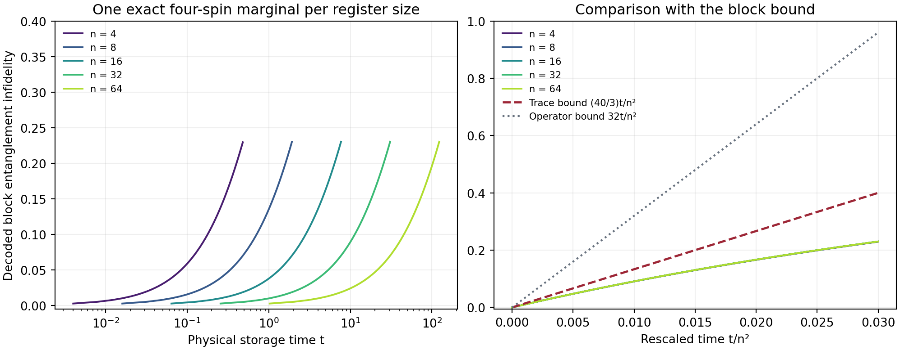

# Inhomogeneous Collective Memory

A register of spins can preserve an extensive unknown quantum state for a time growing quadratically with register size, even when its collective-noise generators have no exact noiseless subsystem. The construction groups spins with nearby known couplings, encodes into their spin-zero sectors, and corrects the remaining correlated errors once, at the storage endpoint.

The result is an achievable size–rate–time law for a specified common-field model. It includes reference-entangled inputs, the classical key used by the protocol, finite calibration precision, and the costs of two endpoint implementations.

[Scientific overview](science/README.md) · [Learning route](learning/README.md) · [Exact theorem and proof](science/storage_theorem.md) · [Resources](science/resources.md) · [Reproduce the checks](verification/README.md) · [Related work](references/related_work.md)

## The model and the main result

There are $`n`$ physical qubits with an arbitrary supplied list $`g_j\in[1,2]`$. They evolve under

```math
\mathcal L_n=\gamma_x\mathcal D[A_x]+\gamma_z\mathcal D[A_z],
\qquad A_x=\sum_jg_jX_j,\qquad A_z=\sum_jg_jZ_j,
```

```math
\mathcal D[A](\rho)=A\rho A-\tfrac12\{A^2,\rho\}.
```

Both rates are positive and fixed independently of $`n`$; the jumps are not normalized by register size. There is no additional Hamiltonian. The two Hermitian jumps describe common fluctuating fields, so different spins and coding blocks experience correlated noise. Encoding and recovery occur only at the boundaries: no control, reset, or measurement takes place during storage.

**For every fixed $`0\lt R\lt 1`$ and $`0\lt \epsilon\lt 1`$, all sufficiently large registers admit storage of at least $`Rn`$ logical qubits with half-diamond error at most $`\epsilon`$ throughout $`0\le t\le c_{R,\epsilon}n^2`$.** This holds for every supplied coefficient list in the interval, without a spacing or probability assumption. The encoder and recovery are fixed across that time interval.

| Guarantee | Construction and qualification | Full account |
|---|---|---|
| Every fixed rate below one; achievable time $`c_{R,\epsilon}n^2`$ | Finite-size theorem, with polynomial endpoints available from fixed-parameter quantum Tanner families | [Theorem](science/storage_theorem.md), [Tanner resources](science/resources.md#3-a-fixed-rate-tanner-outer-family) |
| Rate tends to one and error tends to zero for every $`t_n=o(n^2)`$ | General distance-code existence; no uniform efficient decoder is asserted | [Asymptotic proof](science/storage_theorem.md#82-rate-one-for-every-subquadratic-time-sequence) |
| Rate tends to one with polynomial endpoints for $`t_n=o(n^2/\log^3 n)`$ | Growing-field CSS Reed–Solomon construction with explicit resource accounting | [Constructive alternative](science/resources.md#6-an-explicit-growing-rate-alternative) |
| A fixed $`r`$-parameter Lipschitz family of local coupling vectors | Achievable scale $`n^{2/r}`$, including smoothly varying field directions | [Coupling geometry](science/coupling_geometry.md) |
| Distinct positive scalar couplings | Full associative interaction algebra and a scalar commutant at every finite size | [Symmetry analysis](science/symmetry.md) |

The implemented keyed protocol retains at most $`2n`$ reliable classical bits independent of the input, and no auxiliary quantum carrier. Its error is worst case over inputs and entangled references, averaged over the classical key. A separate deterministic existence argument loses at most one logical qubit and applies to each prescribed storage duration; it does not establish an efficient deterministic compiler or one deterministic code uniform over the whole interval.

## Why the construction works

Dividing coefficient space into narrow bins leaves almost all spins available for fixed-size blocks. Equal-coupling collective operators annihilate a block's spin-zero sector. The small inhomogeneity is quantified by an exact singlet-variance identity, which bounds the decoded block's entanglement infidelity at every time.

Logical Pauli randomization turns the complete decoded channel into a Pauli distribution while retaining its correlations. The expected number of erroneous logical positions is then small. An outer distance code corrects every sufficiently low-weight Pauli error, so an elementary probability bound gives the final half-diamond guarantee. The proof needs no independence or concentration assumption.

For distinct couplings, the register nevertheless approaches the maximally mixed state at fixed size. The achievable storage interval concerns the joint limit of growing size and time. It does not contradict the eventual loss of all quantum information at any fixed size.

## Learn the argument

The [learning overview](learning/README.md) connects a shared map of **30 milestones** to one continuous explanation. The sole educational anchor is **Nielsen and Chuang, *Quantum Computation and Quantum Information*, 10th Anniversary Edition**.

- [Milestone map](learning/milestones.md): twelve background targets and eighteen targets developing the mechanism, theorem, implementation and limits.
- [Anchor bridge](learning/anchor_bridge.md): verified textbook section pointers, notation conventions, and the additional arguments supplied by this project.
- [Continuous tutorial](learning/tutorial.md): eight connected groups covering M01–M30, with an analytic twenty-spin memory built from five four-spin singlet blocks and a five-qubit outer code.

The [scientific overview](science/README.md) provides the direct route to the authoritative assumptions, statements and complete proofs.

## Concrete evidence



Each curve evolves **one four-spin marginal**, using couplings from a register with $`g_j=1+j/n`$. The right panel compares times rescaled by $`n^2`$. A label such as $`n=64`$ does not denote a 64-spin matrix simulation. The plotted block entanglement infidelity and the final memory's half-diamond error are different quantities, connected by the outer-code proof.

The [deterministic suite](verification/README.md) checks 605 block size/time points, singlet trace identities, leakage recovery, exact marginal evolution, a genuinely correlated twirled law, all 1,024 Pauli errors of the five-qubit code, calibration sensitivity, and an independent-depolarization ceiling. Numerical examples support the stated identities and implementation reductions; the asymptotic result is proved analytically.

```bash
python -m pip install -r requirements.txt
python verification/verify_memory.py
```

The recorded environment uses Python 3.12.14. Complete parameters, residuals, data, and software versions are committed alongside the verification source.

## Physical scope and attribution

The assumptions include supplied coupling information, ideal joint endpoint operations, and reliable classical key storage. Certified coefficient accuracy of order $`1/n`$ preserves the fixed-rate quadratic guarantee; the bit count does not price experimental calibration. Gate bounds allow arbitrary addressed spins and do not establish a local hardware depth or a fault-tolerance threshold.

A fixed independent isotropic depolarization rate $`\eta>0`$ makes the physical channel entanglement breaking by $`t=\log 3/\eta`$, independently of register size. The diverging lifetime therefore depends on the common-field noise structure. No optimal-lifetime converse or protection against a generic independent-noise floor is claimed.

Singlet encoding, approximate decoherence-free protection, and concatenation with quantum error correction are established ingredients. [Related work](references/related_work.md) compares the actual models and theorems, including Lidar–Bacon–Whaley's DFS–QECC construction, general Markovian storage results, and the single-generator Quantum Spectral Memory account. The contribution developed here is the uniform storage law and its stated operational and computational consequences.

## Purpose

This repository serves as a record of the work and a guide for the author’s self-directed learning. For discussion or potential collaboration, please contact Ruge Lin at [gogoko699@gmail.com](mailto:gogoko699@gmail.com).
