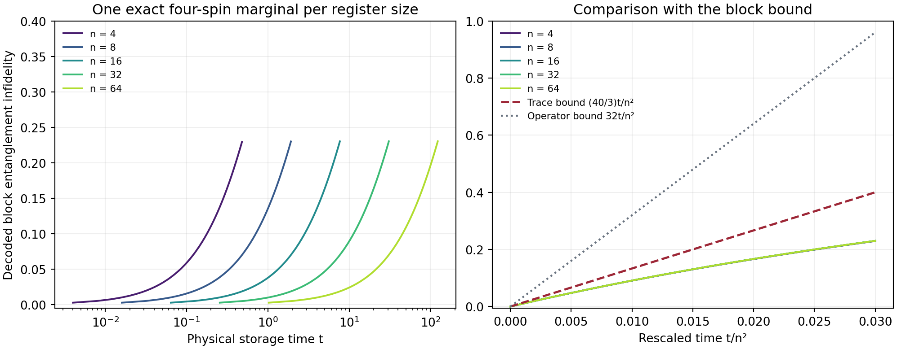

# Explicit examples and verification

This note gives a concrete grid profile, an exact four-spin calculation, correlated-error diagnostics, and a boundary under independent depolarization. The analytic identities and the finite numerical evidence are distinguished throughout. Source code and the complete generated data are in [verification](../verification/README.md).

## 1. A fixed interval of distinct couplings

Take $`n`$ spins with

```math
g_j=1+\frac{j}{n},\qquad
A_x=\sum_{j=1}^{n}g_jX_j,\qquad
A_z=\sum_{j=1}^{n}g_jZ_j,
\qquad
\mathcal L=\mathcal D[A_x]+\mathcal D[A_z].
```

The dissipator convention is

```math
\mathcal D[A](\rho)=A\rho A^\dagger-\frac12\{A^\dagger A,\rho\}.
```

Both field rates equal one, so $`\Gamma=2`$. No factor depending on $`n`$ is inserted into the noise rates. Every coefficient remains between one and two. Consecutive blocks of fixed even size contain increasingly similar coefficients as the register grows.

For an $`m`$-spin consecutive block with midpoint center $`c`$,

```math
\sum_{j\in b}|g_j-c|=\frac{m^2}{4n},
\qquad
\sum_{j\in b}(g_j-c)^2=\frac{m(m^2-1)}{12n^2}.
```

The first identity assumes even $`m`$. The second is the exact variance of equally spaced sites. These give explicit constants for both the operator-spread and trace-variance bounds.

### The trace refinement

The [theorem's attribution and derivation](storage_theorem.md#evaluating-the-full-singlet-average) identify the established singlet moment used here.

Let $`P_m`$ be the full spin-zero projector and $`D_m=\operatorname{tr}P_m`$ its Catalan dimension. Permutation symmetry of $`P_m/D_m`$, together with zero total spin, gives for any fixed Pauli axis $`\alpha`$

```math
\frac{\operatorname{tr}(P_m\sigma_\alpha^{(i)}
\sigma_\alpha^{(j)})}{D_m}
=-\frac{1}{m-1},\qquad i\ne j.
```

Consequently

```math
\frac{\operatorname{tr}(P_m A_\alpha^2)}{D_m}
=\frac{m}{m-1}\sum_j(g_j-\bar g)^2.
```

The mean compressed first moment vanishes. For an encoded Bell state, the expectation of $`A_\alpha^2`$ is exactly this normalized trace. Hermitian jumps make the Liouvillian self-adjoint and negative semidefinite in Hilbert–Schmidt inner product. Applying $`e^u\ge1+u`$ to its spectrum gives a finite-time Bell survival bound; a decoder that is exact on the code can retain that survival contribution. Therefore the decoded block entanglement infidelity obeys

```math
p_b(t)\le \Gamma t\frac{m}{m-1}\sum_j(g_j-\bar g)^2
=\Gamma t\frac{m^2(m+1)}{12n^2}
```

when the entire singlet sector is used as the logical space.

When a qubit register requires a subspace $`Q\le P_m`$ of dimension $`K=2^k`$, positivity gives

```math
\frac{\operatorname{tr}(Q A_\alpha^2)}{K}
\le \rho_m\frac{\operatorname{tr}(P_m A_\alpha^2)}{D_m},
\qquad \rho_m=\frac{D_m}{K}<2
```

for $`k=\lfloor\log_2D_m\rfloor`$. The verification checks this at $`m=4,6,8`$, choosing the $`K`$-dimensional subspace that maximizes the compressed trace. For $`m=6`$, the full mean is $`0.0205078125`$, the worst four-dimensional mean is $`0.02497547755`$, and the bound is $`0.025634765625`$, using grid denominator 32. This deliberately unfavorable subspace still satisfies the estimate. These numbers are finite checks of the displayed general positivity argument, not an optimized coding prescription.

### Nonparallel local coupling vectors

For a Hermitian jump $`A=\sum_j\boldsymbol v_j\cdot\boldsymbol\sigma_j`$, rotational symmetry of the full singlet state gives the more general identity

```math
\frac{\operatorname{tr}(P_m A^2)}{D_m}
=\frac{m}{m-1}\sum_j\|\boldsymbol v_j-\overline{\boldsymbol v}\|_2^2.
```

The same positivity bound applies after selecting a power-of-two subspace. The suite checks two specified, nonparallel vector profiles at $`m=4,6`$. It deliberately verifies that the centered collective part $`B`$ and the residual $`D=A-B`$ do not commute and that $`A^2P_m=D^2P_m`$ fails. Nevertheless their doubly compressed squares agree, and the vector trace formula passes. This distinguishes the trace proof from the older operator argument that needed a fixed polarization axis. The broader geometry statement is developed in [coupling_geometry.md](coupling_geometry.md).

## 2. An exact four-spin block

The four-spin singlet sector has dimension two. We use the explicit logical basis

```math
|0_L\rangle=\frac12\bigl(
|0101\rangle-|0110\rangle-|1001\rangle+|1010\rangle\bigr),
```

```math
|1_L\rangle=\frac1{\sqrt3}\biggl(
|0011\rangle+|1100\rangle
-\frac{|0101\rangle+|0110\rangle+|1001\rangle+|1010\rangle}{2}
\biggr).
```

Let $`E`$ be this isometry and $`P=EE^\dagger`$. The endpoint decoder in the numerical example is

```math
\mathcal R(\rho)=E^\dagger\rho E
+\operatorname{tr}[(I-P)\rho]\cdot\frac{I_2}{2}.
```

It uses the inverse isometry on the code and prepares the fixed maximally mixed logical state after detecting leakage. It is completely positive and trace preserving: take one Kraus operator $`E^\dagger`$ and, for an orthonormal basis $`\{|v_r\rangle\}`$ of the 14-dimensional complement, take $`|a\rangle\langle v_r|/\sqrt2`$ for $`a=0,1`$. These 29 Kraus operators have completeness sum $`I_{16}`$. The code and direct map are both implemented and compared in the verification.

For this example the two rigorous estimates are

```math
p_b(t)\le\frac{40t}{3n^2}
\quad\text{(trace variance)},
\qquad
p_b(t)\le\frac{32t}{n^2}
\quad\text{(operator spread)}.
```

There is also an exact initial-slope identity for this particular leakage reset:

```math
\left.\frac{d}{dt}p_b(t)\right|_{t=0}=\frac{10}{n^2}.
```

Indeed the encoded Bell survival loses $`40/(3n^2)`$ per unit time. The leakage probability has the same initial slope because the jump has zero code-to-code block. Preparing $`I_2/2`$ restores one quarter of that leakage probability to entanglement fidelity. The resulting infidelity slope is three quarters of $`40/(3n^2)`$. This identity is an independent normalization check on the exact evolution and decoder.

### Computed example

The script diagonalizes each 256-by-256 Liouvillian and evaluates its exponential without a time-step discretization. For every even register size listed below, the four simulated sites are $`j=n/2-1,\ldots,n/2+2`$. All other physical spins are eliminated using the exact marginal-channel identity in the next section. The table fixes rescaled time $`t/n^2=0.01`$.

| Register size $`n`$ | Physical time $`t`$ | Decoded entanglement fidelity | Leakage probability | Trace bound on infidelity |
|---:|---:|---:|---:|---:|
| 4 | 0.16 | 0.909289 | 0.116386 | 0.133333 |
| 8 | 0.64 | 0.909051 | 0.116853 | 0.133333 |
| 16 | 2.56 | 0.908972 | 0.117008 | 0.133333 |
| 32 | 10.24 | 0.908950 | 0.117050 | 0.133333 |
| 64 | 40.96 | 0.908945 | 0.117061 | 0.133333 |

The complete table is [block_selected_times.csv](../verification/results/block_selected_times.csv). The [full curve data](../verification/results/block_dynamics.csv) contain 605 points, including both bounds and channel-positivity diagnostics.



The right panel displays a close, finite-size overlap after rescaling time. No exact scaling collapse or optimal storage exponent is inferred from the plot. The plotted quantity is a block entanglement infidelity; the final memory's half-diamond guarantee uses the separate outer-code argument.

## 3. Why spectator correlations do not change a marginal

For a partition into a retained block and its complement, write a Hermitian collective jump as $`A\otimes I+I\otimes B`$. Its dissipator is

```math
\mathcal D[A+B](\rho)=-\frac12[A+B,[A+B,\rho]].
```

Every term with an outer commutator by $`B`$ vanishes under partial trace. The other mixed term is $`[A,\operatorname{tr}_B[B,\rho]]`$ and also vanishes. Thus, for every operator $`X`$, including correlated states and non-Hermitian matrix units,

```math
\operatorname{tr}_B\mathcal L_{AB}(X)
=\mathcal L_A(\operatorname{tr}_B X),
\qquad
\operatorname{tr}_B e^{t\mathcal L_{AB}}(X)
=e^{t\mathcal L_A}(\operatorname{tr}_B X).
```

The verification constructs both linear maps and checks their equality on the entire 256-dimensional operator space of a four-spin system split into two pairs. The residual norm is approximately $`1.3\times10^{-15}`$. The separately traced cross dissipators vanish numerically. A nonuniform entangled Schmidt state evolved to $`t=0.37`$ gives a marginal-evolution residual below $`1.5\times10^{-15}`$. The linear-map identity, rather than the one example state, is the part that addresses arbitrary spectator correlations.

## 4. Pauli twirling preserves correlations

Independent logical Pauli keys remove off-diagonal Pauli-transfer entries. They do not make the physical errors independent. For a diagnostic with two four-spin blocks, the script uses a specified finite ensemble of common rotations:

```math
U_g=e^{-i\theta_z g Z}e^{-i\theta_x g X},
\qquad
(p,\theta_x,\theta_z)\in
\{(0.65,0,0),(0.20,0.9,-0.6),(0.15,2.1,1.3)\}.
```

This is an algebraic test ensemble, not a sampled Brownian process. It evolves, decodes, and directly twirls the joint two-logical-qubit channel. It independently computes the conditional product Pauli laws and averages them. The two answers agree within $`2.5\times10^{-16}`$.

Each block has nonidentity probability approximately $`0.0720493`$. The probability that both are nonidentity is approximately $`0.0214598`$, giving covariance $`0.0162687`$. Thus the output distribution is substantially correlated. The direct twirl removes off-diagonal transfer entries to below $`1.6\times10^{-18}`$ while retaining those correlations. The full distribution is saved in [correlated_twirl_pauli_law.csv](../verification/results/correlated_twirl_pauli_law.csv).

The explicit implementation keeps two classical Pauli-key bits per inner logical qubit during storage. The key is independent of the unknown quantum input. It is removed after inner decoding and before outer recovery. A deterministic key-free existence argument, when invoked elsewhere, is a separate expurgation argument and does not follow merely by fixing a key in this numerical test.

## 5. Outer correction under an explicitly correlated law

For a small exhaustive check, use the standard five-qubit code with stabilizer generators

```math
XZZXI,\quad IXZZX,\quad XIXZZ,\quad ZXIXZ,
```

and logical Paulis $`XXXXX`$ and $`ZZZZZ`$. Five-qubit correction is an established construction [1]. Combining four-spin singlets, leakage handling, and outer error correction is also established [2]; the test is not a novelty claim for those ingredients.

The script builds all 16 syndrome projectors and the complete recovery channel. It enumerates every one of the $`4^5=1024`$ physical Paulis, verifies all identity and single-site errors are corrected, and records the residual logical Pauli for every larger error. The recovery completeness and Pauli-classification residuals vanish at the recorded floating-point precision.

Two deliberately correlated distributions then exercise the error bound:

| Specified physical law | Exact logical half-diamond error | Probability of weight above one | Integer bound $`\mathbb E W/2`$ | Bound $`p_{\max}/q`$, $`q=1/5`$ |
|---|---:|---:|---:|---:|
| Identity with probability 0.98; $`XXXXX`$ with probability 0.02 | 0.02 | 0.02 | 0.05 | 0.10 |
| Identity 0.94; each single-site $`Z`$ 0.006; $`XXIII`$ 0.02; $`XXXXX`$ 0.01 | 0.03 | 0.03 | 0.06 | 0.18 |

The first distribution has perfectly correlated errors on all five sites. For any correlated Pauli distribution, if $`W`$ is its weight and every weight at most $`qM`$ is corrected,

```math
\frac12\|\mathcal R\mathcal N\mathcal E-\mathrm{id}\|_\diamond
\le\Pr(W>qM)
\le\frac{\mathbb E W}{qM}
\le\frac{p_{\max}}q.
```

For an integer correction radius $`r`$, the sharper finite-length bound is $`\Pr(W>r)\le\mathbb E W/(r+1)`$. The table uses $`r=1`$, so its integer Markov denominator is two. The looser $`p_{\max}/q`$ expression is retained alongside it to show the general theorem's convention.

Only the expectation of the weight is used. In the examples, the recovered channel is itself a logical Pauli channel, whose half-diamond distance from identity is exactly its nonidentity probability. A maximally entangled input attains this value because distinct Pauli errors give orthogonal Bell states. Thus the quoted diamond errors are exact for the specified laws; they are not inferred from an average-input fidelity or a Monte Carlo estimate.

## 6. Calibration sensitivity

Suppose estimated coefficients in a block lie in an interval of width $`\Delta`$ and each estimate has error at most $`\eta`$. Relative to the estimated midpoint, the actual coefficients satisfy

```math
d_b\le m(\Delta/2+\eta).
```

The conservative operator estimate therefore gives

```math
p_b(t)\le\Gamma t m^2(\Delta/2+\eta)^2.
```

The trace estimate additionally uses

```math
\sum_j(g_j-\bar g)^2
\le\sum_j(g_j-\widehat c)^2
\le m(\Delta/2+\eta)^2,
```

and hence gives

```math
p_b(t)\le
\Gamma t\rho_m\frac{m^2}{m-1}(\Delta/2+\eta)^2.
```

For fixed block size and a quadratic storage interval, an error envelope of order $`1/n`$ preserves a size-independent bound. A fixed nonzero calibration error makes these bounds grow with $`n^2`$ and eventually makes them uninformative. This is a limitation of the stated guarantee; it is not a converse for every possible protocol under calibration uncertainty.

The saved [calibration examples](../verification/results/calibration_examples.csv) perturb the first two coefficients downward and the last two upward. At $`t=0.005n^2`$, zero calibration error gives decoded infidelity approximately 0.0477 for $`n=16,32,64`$. An error $`\eta=1/n`$ gives approximately 0.1444–0.1446. A fixed error $`\eta=0.01`$ gives 0.0600, 0.0738, and 0.1050 respectively. These are explicit finite examples of sensitivity, with actual-coefficient bounds and estimated-envelope bounds stored separately.

## 7. A fixed independent depolarization rate stops the divergence

Add isotropic independent noise with generator

```math
\mathcal L_{\mathrm{ind}}=
\frac{\eta}{4}\sum_{j=1}^n\sum_{\alpha=x,y,z}
\mathcal D[\sigma_\alpha^{(j)}].
```

Its one-spin channel is

```math
\mathcal P_t(\rho)=e^{-\eta t}\rho
+(1-e^{-\eta t})\frac{I_2}{2}\operatorname{tr}\rho.
```

Isotropic depolarization is covariant under every one-spin rotation. Its tensor power therefore commutes with every conditional product rotation generated by the common fields, and with the collective-noise channel. The combined evolution factors as

```math
e^{t(\mathcal L+\mathcal L_{\mathrm{ind}})}
=\mathcal P_t^{\otimes n}\circ e^{t\mathcal L}.
```

For a qubit depolarizing channel with Bloch contraction $`a=e^{-\eta t}`$, the normalized Choi state's partial transpose has smallest eigenvalue $`(1-3a)/4`$. It is entanglement breaking exactly when $`a\le1/3`$ [3,4]. At the threshold there is a direct measure-and-prepare implementation: choose a Pauli axis uniformly, measure it, and prepare the measured eigenstate. Smaller contractions are convex mixtures with complete depolarization.

Thus the full physical channel is entanglement breaking for

```math
t\ge\frac{\log3}{\eta},
```

independently of $`n`$. Encoding and endpoint recovery, including an input-independent retained classical key, cannot restore entanglement through an entanglement-breaking channel. For a logical space of dimension $`K\ge2`$, its output on an encoded Bell input is separable and has Bell overlap at most $`1/K`$. Consequently any recovered channel has

```math
\frac12\|\mathcal M-\mathrm{id}_K\|_\diamond
\ge1-\frac1K
```

at those times. A fixed independent depolarization rate therefore rules out vanishing storage error over a diverging interval in this model.

The verification checks generator commutation on two spins, the partial-transpose eigenvalues on both sides of the threshold, and the threshold measure-and-prepare map. For $`\eta=0.4`$, the ceiling time is approximately 2.74653.

An isolated spin under the two common-field terms alone also becomes entanglement breaking after the constant time $`\log(1+\sqrt2)/(2g_j^2)`$, by its Bloch multipliers $`(e^{-2g_j^2t},e^{-4g_j^2t},e^{-2g_j^2t})`$ and the unital-qubit criterion [3]. Single-spin marginals being entanglement breaking does not imply that a collectively correlated register channel is entanglement breaking. The independent tensor-product factor in the preceding argument is what makes the global ceiling follow.

## Primary references for inherited ingredients

1. R. Laflamme, C. Miquel, J. P. Paz, and W. H. Zurek, *Perfect Quantum Error Correction Code* (1996), [arXiv:quant-ph/9602019](https://arxiv.org/abs/quant-ph/9602019).
2. D. A. Lidar, D. Bacon, and K. B. Whaley, *Concatenating Decoherence Free Subspaces with Quantum Error Correcting Codes*, Physical Review Letters **82**, 4556 (1999), [arXiv:quant-ph/9809081](https://arxiv.org/pdf/quant-ph/9809081).
3. M. B. Ruskai, *Qubit Entanglement Breaking Channels* (2003), Theorem 4, [arXiv:quant-ph/0302032](https://arxiv.org/pdf/quant-ph/0302032).
4. M. Horodecki, P. W. Shor, and M. B. Ruskai, *Entanglement Breaking Channels* (2003), Theorems 2–4, [arXiv:quant-ph/0302031](https://arxiv.org/pdf/quant-ph/0302031).
